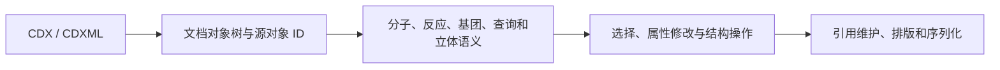

# ChemDraw 26 反编译分析与现有引擎集成评估

分析日期：2026-11-05。后续独立实现已将有效输入的导入和适用编辑保存回读成功数从 337 提升到 685；本报告中的 337 和下述差距是初轮反编译评估时的历史基线，当前结果见 [引擎升级](engine-upgrade.md)。

已经完成第一轮静态反编译：3 个 .NET 程序集生成 424 个 C# 文件，`CoreChemistryCommon.dll` 的 14 个选定原生函数生成伪代码。没有恢复完整原始 C++ 工程，也没有将反编译代码接入产品。本次执行的是分析工具，未加载或运行 ChemDraw DLL。

原始反编译产物、工具及完整符号表放在本机 `.local/chemdraw26-analysis/`，该目录已由现有 Git 规则忽略。本报告记录结论、地址和改造方案，不包含成段反编译实现。

后续本轮继续核对 `CDXBracketedGroup::StoreAttribute` 的 `0x0A24–0x0A2A` 字段分派，结合公开规范补上 `bracketattachment/crossingbond` 与 `0x0A2B–0x0A2D` 引用。已独立实现聚合物括号组的类型化编辑、FLOAT64 重复次数、嵌套成员及跨界连接校验，并通过 CDX/CDXML 来源保存与独立字节解析器验证。见 [本轮功能与边界](polymers.md)。此项不是恢复或集成完整 ChemDraw 核心实现。

后续又在已解析的节点／内部片段／端口映射基础上，独立实现单层及递归缩写展开、构型保护和原生 XML 节点提升。没有声称从伪代码恢复了 ChemDraw 的标签展开算法。532 个顶层缩写中，282 个完成展开及来源保存回读；250 个因明确歧义或整体语义保留原状。另用原生 RDKit 比较原始嵌套结构和展开结构，见 [展开说明](abbreviation-expansion.md)。

## 输入与工具

- 输入安装包：`ChemDraw_26.0.0.msi`，MSI 产品信息为 `Revvity ChemDraw Applications 26.0.0 x64`。
- 安装包 SHA-256：`9e9b43a1de883d7648a59f8f18fbbabae3bea8d0293e38d8bc5e3d98c31a2998`。
- 使用 ILSpyCmd 7.2.1.6856 读取程序集及 IL，利用本机已有 .NET 6 运行时生成 C#。
- 使用 Rizin 0.9.1 与 Cutter 2.5.0 官方发行包中的 rz-ghidra 插件及 x86 规格，静态分析 AMD64 PE 文件，生成 Ghidra 伪代码。
- 工具来源：[ILSpy](https://github.com/icsharpcode/ILSpy)、[Rizin 官方发行](https://github.com/rizinorg/rizin/releases/tag/v0.9.1)、[Cutter 官方发行](https://github.com/rizinorg/cutter/releases/tag/v2.5.0)。

## 模块定位

| 文件 | 静态检查结果 | 对当前项目的价值 |
| --- | --- | --- |
| `CambridgeSoft.ChemScript.dll` | 纯 IL 程序集，已生成 C#；大量 SWIG/PInvoke 调用 | 确认加载、保存、原子、键、反应及标准化等对外接口；主要是调用层 |
| `Revvity.ChemDraw.ChemDrawDotNET.dll` | 纯 IL 程序集，已生成 C# | 文档属性、HELM 和插件等桌面界面组织方式 |
| `Interop.ChemDraw.dll` | COM 互操作程序集，已生成 C# | 桌面对象模型的接口、属性和类型定义 |
| `ChemDrawBase.dll` | AMD64 原生代码，12,032 个命名导出，其中 971 个名称匹配格式／结构相关关键词 | 编辑文档、缩写和图形等功能入口；关键词统计不等于独立算法数量 |
| `ChemDrawCtl.dll`、`ChemScript.dll` | 含 CLR 目录但非纯 IL，为混合程序集 | 托管调用与原生实现之间的连接；不能仅因存在 CLR 目录就认为全部可还原为 C# |
| `CoreChemistryCommon.dll` | AMD64 原生代码，8,244 个命名导出 | 定位到 CDX/CDXML 对象、读取、属性存储、反应、立体化学和芳香性实现 |

`CoreChemistryCommon.dll` SHA-256：`154bb6d63073e12628cc2372b9c9180ed780c78833bc3a26d8880f2b0abd639c`。以下地址均对应此版本，RVA 以模块起始地址为基准，分析基址为 `0x180000000`。

## 已反编译的原生函数

| 函数 | RVA | 分析用途 |
| --- | --- | --- |
| `CDXObjectFactory::AllocateObject` | `0x44f600` | 对象类型注册与分派；未知类型有通用对象路径 |
| `CDXObjectFactory::ReadOneObject` | `0x44f3b0` | 区分对象与属性，建立顶层对象 |
| `CDXObject::ReadFrom` | `0x4500e0` | 读取嵌套对象和属性，建立父子关系 |
| `CDXObject::ReadOneAttribute` | `0x450260` | 16 位长度、扩展长度与属性处理 |
| `CDXObject::StoreAttribute` | `0x44fd00` | 保留未由具体子类解释的属性数据 |
| `CDXDataSource::GetINT` | `0x4466c0` | 整数读入辅助函数；需结合汇编核对返回值与符号扩展 |
| `CDXDataSource::GetUINT` | `0x4465b0` | 无符号整数读入辅助函数；伪代码类型恢复存在局限 |
| `CDXMLParser::Parse` | `0x448980` | CDXML 解析入口及文档构造 |
| `CDXNode::StoreAttribute` | `0x44a410` | 节点种类、电荷、自由基、几何及连接顺序等属性 |
| `CDXBond::StoreAttribute` | `0x422a80` | 键级、描绘、端点与键顺序引用等属性 |
| `CDXReactionStep::StoreAttribute` | `0x45bc50` | 反应角色、箭头、映射与文档对象引用 |
| `CDXBracketedGroup::StoreAttribute` | `0x4257b0` | 聚合物／括号组的类型、成员和重复信息 |
| `ccStereoCIP::DetermineParities` | `0x397120` | 立体解释依赖关系；不是完整 CIP 引擎的全部实现 |
| `ccAromaticityInfo::FindAromaticSystems` | `0x1caa10` | 芳香性处理入口及其依赖；内部子程序仍需继续分析 |

## 能从分析中确认什么

### 先建立文档树，再解释化学

对象读取函数递归构造子对象，并按类型交给不同的属性处理函数。通用对象还保留未解释的属性载荷。该行为说明需要区分以下层次：

保留一个未知字段，并不意味着已经理解其化学意义。完整可编辑的验收不能只检查文件载入不报错。

### 原子与键需要独立的拓扑立体信息

`CDXNode::StoreAttribute` 分别处理 `0x0430` 几何和 `0x0431` 键顺序；`CDXBond::StoreAttribute` 对 `0x060b` 建立对象 ID 列表。这与公开格式规范中的 Geometry、BondOrdering、BondCircularOrdering 相互印证。

当前 `Atom`、`Bond` 没有这些语义字段。仅取消导入拒绝会丢失约束，因而不能算完整支持。

电荷处理还印证了当前解析器中的历史兼容逻辑：一字节电荷在内部被左移 24 位，四字节值采用内部形式。现有的四字节电荷高字节处理具有对应依据，不能套用二维坐标的 16.16 缩放。

### 反应需要维护引用和成对映射

反应步骤处理函数对不同载荷分别检查长度：普通对象引用采用 4 字节元素，原子映射采用成对引用的 8 字节元素。不能把反应文档扁平化成一张无角色的分子图。

### 聚合物和缩写需要独立对象

括号组处理包括组类型、成员引用、重复／翻转信息及标签。缩写／嵌套片段也依赖文档层级和外部连接点。它们需要可编辑的数据对象以及对原子、键的引用维护。

### CIP 依赖比标签复杂

已分析的 `DetermineParities` 调用链涉及邻接、价态、芳香性、环信息、图形立体判断和四面体模型。给原子增加 `R/S` 字符串不能替代这些计算，也不能保证结构编辑后的构型正确。

## 怎样接入现有引擎

建议保留当前 Web Component、撤销、插件和 AI 接口的整体结构，扩展它们所操作的数据模型与编辑操作。文件读取能力和化学解释能力应分开验证。

| 现有入口 | 建议改造 | 必须通过的验证 |
| --- | --- | --- |
| `src/formats/cdx.ts`、`src/formats/xml.ts` | 统一的对象树／对象注册表；格式层读取页、片段、嵌套组及引用 | 类型、成员、作用域、悬空引用、截断和大小限制 |
| `src/core/types.ts` | 设计可迁移的完整文档模型，增加几何立体、键顺序、反应步骤、查询、缩写与聚合物 | 旧 JSON 迁移；稳定 ID；反应角色和立体约束不丢失 |
| `src/core/model.ts` | 增加各对象的语义校验、引用校验和派生状态失效机制 | 删除／改接后不得留下过期引用、缓存或构型 |
| `src/core/edits.ts` | 为反应、查询、基团和立体约束增加明确的批量编辑操作 | 原子化提交、失败回滚、撤销重做 |
| `src/editor/render.ts`、`src/editor/chemical-editor.ts` | 对反应箭头、组边界、缩写展开和立体属性提供显示及编辑交互 | 不是只读预览；用户操作后数据与画布一致 |
| `src/formats/preservation.ts` 及写入器 | 维护对象引用、顺序、映射和组合对象；同步 CDX/CDXML 写入 | 解析 → 修改 → 保存 → 重读后，所有已支持化学语义一致 |
| `src/ai/assistant.ts` | 在新操作经过验证后，扩充工具白名单及上下文 | AI 使用完整模型；不将复杂结构投影成有损的普通分子再编辑 |

原生 DLL 不能直接作为浏览器模块加载。已检查的主库依赖 Windows 系统库及 MSVC 运行时；移植到 TypeScript 或 WebAssembly 还需要替换这些依赖，并重建相关类型和算法。当前伪代码不足以直接编译成可分发的完整引擎。

实际实施顺序建议：先补齐对象／引用与立体约束模型，再实现反应，随后处理缩写、查询与聚合物；每个特征同时完成编辑和双格式写入验证。CIP、芳香性和自动清理作为明确的计算模块接入，而不是导入时忽略相关字段。

## 批量文件的验收标准

用户要求是完整解析并可编辑全部化学内容，不采用只读模式或静默降级计数。

- 本地共 687 个扩展名为 CDX/CDXML 的文件。
- 两个 `Example.001/Input/file04.cdxml`、`Example.002/Input/file04.cdxml` 实际文本为 `THIS FILE IS NOT A VALID INPUT FILE`，是故意无效的测试输入，应报错。
- 其余 685 个文件仍需按化学内容分型验证。大型图表中的化学结构与非化学文档对象也应分别核对。
- 本轮之前的现有引擎验证结果是 337 个可导入，且这 337 个通过源文件取回与整体平移后的源格式保存检查；**本次反编译没有提高该计数**。
- 未完成全部核心算法恢复、完整文档模型、完整 UI 编辑或全部 685 个有效文件的验收。不能把生成伪代码当作已经实现这些功能。

## 分析可靠性与后续证据

Ghidra 输出中仍有未知类型、寄存器参数和间接调用恢复警告；部分辅助函数的返回类型被推断成 `void`，与导出签名不符。此类结果必须回看汇编并用小型文件验证，不能逐行照搬。这里只将可识别的调用关系、对象结构及经规范交叉核对的数据格式事实用于集成评估。

本机入口索引：`.local/chemdraw26-analysis/README.md`；原生函数记录：`.local/chemdraw26-analysis/native/results.json`；程序集分类：`.local/chemdraw26-analysis/pe-inventory.json`。

格式核对资料：[公开归档 ChemDraw SDK](https://iupac.github.io/IUPAC-FAIRSpec/cdx_sdk/)、[Atom Geometry](https://iupac.github.io/IUPAC-FAIRSpec/cdx_sdk/properties/Atom_Geometry.htm)、[Node Type](https://iupac.github.io/IUPAC-FAIRSpec/cdx_sdk/properties/Node_Type.htm)。
